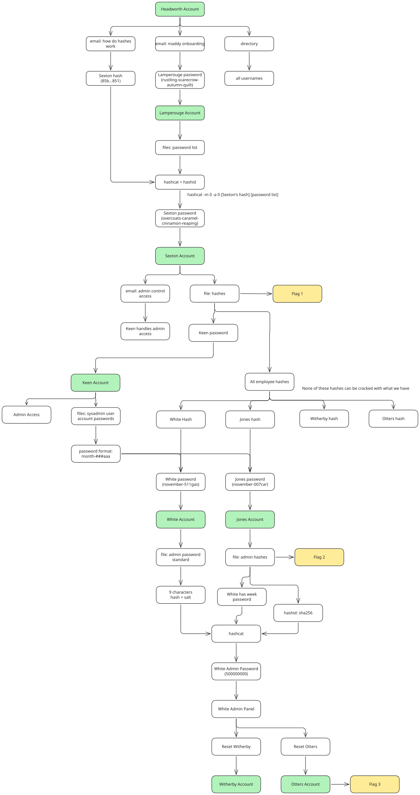

# Fall Challenge 8: Otter Management Portal

**Category**: web    
**Points**: 150 (3 flags)     
**Description**:  
Last month Otter Security was breached, their files were all encrypted with xor chain cyphers, and all their data got spilled onto the open internet. Since then they have brought in a new director for their security department, and are now in the process of migrating to a more secure system.

Just before we lost access, we managed to get some of the new creds, for one of their acountants. Can you crack their passwords and leak their files again?

---

# Approach

This challenge involves navigating Otter Security's management portal and compromising increasingly privileged user accounts. Each account has its own `emails` and `files` which contain the information needed to compromise other accounts. Some accounts have access to an `admin portal` which will be discussed later. Every account has access to the `staff directory` which includes each employee's name, position, and username.

This challenge focuses on cracking hashes. I used `hashid` to identify what type of hash I had and `hashcat` to crack them. A basic `hashcat` command follows this form:

```
hashcat -m [mode] -a [attack type] [hash(s)] [attack-specific input]
```

The two types of attacks used in this challenge are the dictionary attack and mask attack. A dictionary attack uses a list of common passwords that `hashcat` will hash and compare against the target hash. A mask attack allows you to specify a pattern that the password will be in so that `hashcat` can check every permutation of the pattern.

# Flag 1

## Carol Headworth

We are given the credentials for Carol Headworth, the accountant in the challenge description. From the management portal we can view the `staff directory` below:

```
Name               | Position                      | Username
================================================================
Izzy Witherby      | Director of Security          | iwitherby
Carol Headworth    | Acountant                     | cheadworth
Steve Otters       | Chief Executive Officer       | sotters
Luke White         | Senior IT Technitian          | lwhite
Elizabeth Keen     | Senior Security Analyst       | ekeen
Maddy Sexton       | Junior Security Analyst       | msexton
Scott Jones        | Security Analyst              | sjones
Lelouch Lamperouge | Human Services Representative | llamperouge
```

Let's use this table to track what information we know about each employee.

In Headworth's emails there is an email titled `how do hashes work` sent by Maddy Sexton which includes a hash (`85b37c6584c6cc319304ea8f7764f851`) that is most likely Sexton's own password hash.

Another email titled `maddy onboarding` includes Lelouch Lamperouge accidentally sending their password (`rustling-scarecrow-autumn-quilt`) to Headworth.

Here's what we know so far:

```
Name               | Position                      | Username     | Password                            | Hash
=================================================================================================================
Izzy Witherby      | Director of Security          | iwitherby    |                                     |
Carol Headworth    | Acountant                     | cheadworth   | chilly-dried-sweater-evergreen      |
Steve Otters       | Chief Executive Officer       | sotters      |                                     |
Luke White         | Senior IT Technitian          | lwhite       |                                     |
Elizabeth Keen     | Senior Security Analyst       | ekeen        |                                     |
Maddy Sexton       | Junior Security Analyst       | msexton      |                                     | 85b37c6584c6cc319304ea8f7764f851 <
Scott Jones        | Security Analyst              | sjones       |                                     |
Lelouch Lamperouge | Human Services Representative | llamperouge  | rustling-scare-crow-autmn-quilt <   |
```

## Lelouch Lamperouge

With the usernames for all employees from the `staff directory` and Lamperouge's password from Headworth's emails, we can access Lamperouge's account. In their files there is a password list (`fall_passwords.txt`) containing thousands of permutations on the password format the company uses. We can use this password list to conduct a dictionary attack on Sexton's hash we retrieved from Headworth's emails.

First, use `hashid` to find that the hash is most likely `MD5` using the following command:

```
hashid 85b37c6584c6cc319304ea8f7764f851
```

Next, conduct a dictionary attack using `hashcat`. The `-m` flag specifies the hash type (`0` for unsalted MD5) and the `-a` flag specifies the attack type (`0` for dictionary).

```
hashcat -m 0 -a 0 85b37c6584c6cc319304ea8f7764f851 fall_passwords.txt
```

This gives us Sexton's password (`overcoats-caramel-cinnamon-reaping`). Here's what we know so far:

```
Name               | Position                      | Username     | Password                            | Hash
=================================================================================================================
Izzy Witherby      | Director of Security          | iwitherby    |                                     |
Carol Headworth    | Acountant                     | cheadworth   | chilly-dried-sweater-evergreen      |
Steve Otters       | Chief Executive Officer       | sotters      |                                     |
Luke White         | Senior IT Technitian          | lwhite       |                                     |
Elizabeth Keen     | Senior Security Analyst       | ekeen        |                                     |
Maddy Sexton       | Junior Security Analyst       | msexton      | overcoats-caramel-cinnamon-reaping <| 85b37c6584c6cc319304ea8f7764f851
Scott Jones        | Security Analyst              | sjones       |                                     |
Lelouch Lamperouge | Human Services Representative | llamperouge  | rustling-scare-crow-autmn-quilt     |
```

## Maddy Sexton

Accessing Sexton's account gives us access to a `file` titled `hashes`. This file includes our first flag along with a list of all employee's password  hashes and Elizabeth Keen's password.

Here's our updated table:

```
Name               | Position                      | Username     | Password                            | Hash
=================================================================================================================
Izzy Witherby      | Director of Security          | iwitherby    |                                     | 425d6f4ff4639f2598b2dc613f86eef6 <
Carol Headworth    | Acountant                     | cheadworth   | chilly-dried-sweater-evergreen      | c29f3d4c19867887c5f1c078a8bfc1d5 <
Steve Otters       | Chief Executive Officer       | sotters      |                                     | 10a1e0a1e8b4c7982242e76bd7be5adf <
Luke White         | Senior IT Technitian          | lwhite       |                                     | 3dcbdeff25d8cc5d3ec918e362ba62f0 <
Elizabeth Keen     | Senior Security Analyst       | ekeen        | lattes-ginger-yellow-maize <        | e2a5fe40b839cb6dbdbfe70e49033f69 <
Maddy Sexton       | Junior Security Analyst       | msexton      | overcoats-caramel-cinnamon-reaping  | 85b37c6584c6cc319304ea8f7764f851 <
Scott Jones        | Security Analyst              | sjones       |                                     | 038c634f11692f64eace22128eafea49 <
Lelouch Lamperouge | Human Services Representative | llamperouge  | rustling-scare-crow-autmn-quilt     | 116effbd0234d1fc2379788599d86d10 <
```

Attempting to crack these new hashes with the dictionary attack does not work.

# Flag 2

## Elizabeth Keen

In a file titled `sysadmin user account passwords` we find the password format that the company's sysadmins use, which is `month-###aaa` where `#` denotes a digit and `a` denotes a character. This explains why the dictionary attack didn't work for Witherby, Otters, White, keen, or Jones.

We can use hashcat to execute a mask attack (attack type `3`) by supplying the format. `?d` denotes a digit and `?a` denotes a character. Hashcat will try every combination until it cracks the hashes.

```
hashcat -m 0 -a 3 hashes.txt "november-?d?d?d?a?a?a"
```

This gives us the passwords for Luke White and Scott Jones, but not Steve Otters or Izzy Witherby. Let's add them to the table:

```
Name               | Position                      | Username     | Password                            | Hash
=================================================================================================================
Izzy Witherby      | Director of Security          | iwitherby    |                                     | 425d6f4ff4639f2598b2dc613f86eef6
Carol Headworth    | Acountant                     | cheadworth   | chilly-dried-sweater-evergreen      | c29f3d4c19867887c5f1c078a8bfc1d5
Steve Otters       | Chief Executive Officer       | sotters      |                                     | 10a1e0a1e8b4c7982242e76bd7be5adf 
Luke White         | Senior IT Technitian          | lwhite       | november-511gas <                   | 3dcbdeff25d8cc5d3ec918e362ba62f0
Elizabeth Keen     | Senior Security Analyst       | ekeen        | lattes-ginger-yellow-maize          | e2a5fe40b839cb6dbdbfe70e49033f69
Maddy Sexton       | Junior Security Analyst       | msexton      | overcoats-caramel-cinnamon-reaping  | 85b37c6584c6cc319304ea8f7764f851
Scott Jones        | Security Analyst              | sjones       | november-007car <                   | 038c634f11692f64eace22128eafea49
Lelouch Lamperouge | Human Services Representative | llamperouge  | rustling-scare-crow-autmn-quilt     | 116effbd0234d1fc2379788599d86d10
```

## Luke White

White has a file titled `admin password standard` which tells us that admin passwords are 9 random characters with a salt at the end.

## Scott Jones

Jones has a file titled `admin hashes` which contains the admin hashes (including the salt) for all sysadmins. This file also includes Flag 2.

```
Izzy - 931ffe52496008157615a9930aa5a695713e1482f64bf2b608ef4443339bbe69:cornucopia
Steve - 0d5d17188850db4cc68d46e6fa3391d57dd1d3d3e2c7b2eda8c50222c3598d9b:cornucopia
Luke - f9972ac3ecda9179bb8facc1dd42e9d44a2cccadb8cc74af58fa71d79a93881b:cornucopia
Elizabeth - 249bf7e554e2264932ed3416e6fea3b4d719fbd78a9b0310a4ed416a387967d7:cornucopia
Me - d970fe98b0861ef1c63de62d3c0a6724684b3fac695042d7038065ac1b420e08:cornucopia
```

Jones has an email which hints that Luke White has a weak admin password.

# Flag 3

Using `hashid` we can learn that the admin hashes use sha256 instead of MD5. With this knowledge we can perform another mask attack on Luke White's hash using `hashcat` like so (`1410` corresponds to the sha256 + hash mode):

```
hashcat -m 1410 -a 3 f9972ac3ecda9179bb8facc1dd42e9d44a2cccadb8cc74af58fa71d79a93881b:cornucopia "?a?a?a?a?a?a?a?a?a"
```

This gives us White's very secure admin password of `500000000`. The rest of the admin passwords appear to be too secure to crack in a reasonable time, as there are over 500 quadrillion possible passwords that are 9 characters long and consist of the 94 printable ASCII characters.

## Luke White

Logging back into White and accessing his `admin portal` gives us the ability to reset any user's password. Since the only accounts we haven't been able to access are Izzy Witherby and Steve Otters, let's reset those.

## Steve Otters

Since Steve Otters is the CEO, I accessed his account first. In a file titled `project dam`, the third and final flag is found.

# Retrospect

There are many more interesting emails that I did not include in this writeup. I found reading them all to be quite helpful as they provide some helpful hints. They are also very entertaining :)

Here's a nice flowchart showing my progression through the system:


